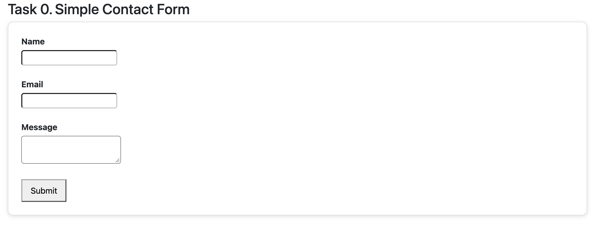
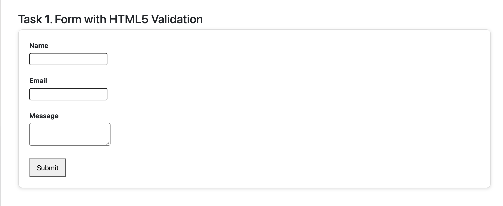
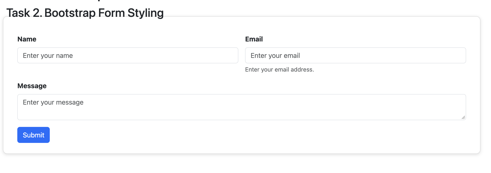
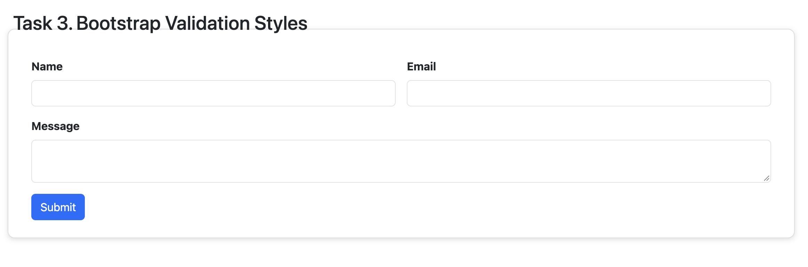
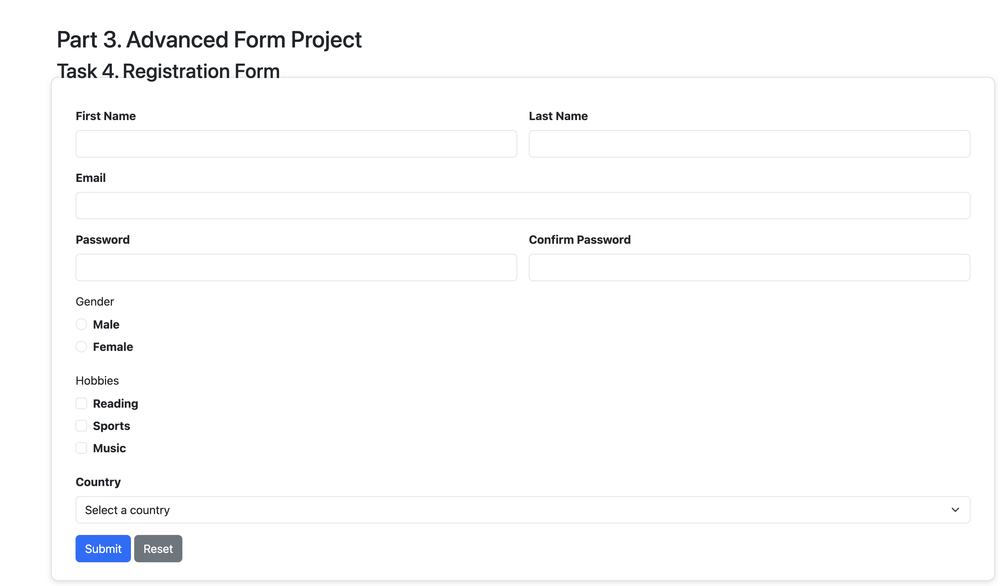

# Assignment #4. Forms and Validation

**Student Name:** [Adilgereyev Nuraly]

**Group:** [SE-2539]

## Part 1. Basic HTML Forms

### Task 0. Simple Contact Form

Created a basic HTML contact form with Name, Email, Message and Submit button.

All fields have corresponding labels.

### Task 1. Form with HTML5 Validation

Added HTML5 validation using:

- `required`
- `type="email"`
- `maxlength`

Tested the form with empty fields and invalid email addresses.

## Part 2. Bootstrap Forms

### Task 2. Bootstrap Form Styling

Recreated the contact form using Bootstrap 5.3.

Used Bootstrap Grid, form controls, labels, placeholders and helper text.

### Task 3. Bootstrap Validation Styles

Added Bootstrap validation using:

- `is-valid`
- `is-invalid`
- `valid-feedback`
- `invalid-feedback`

Tested the form with valid and invalid input values.

## Part 3. Advanced Form Project

### Task 4. Registration Form

Created a responsive registration form with:

- First Name
- Last Name
- Email
- Password
- Confirm Password
- Gender
- Hobbies
- Country
- Submit button
- Reset button

Used Bootstrap Grid for responsive layout.

Added HTML5 validation and Bootstrap validation feedback.

The password must contain at least 8 characters.

JavaScript checks whether the passwords match.

## Work Process Summary

First, I created basic HTML forms with input fields and labels.

Then, I added HTML5 validation attributes.

Next, I styled the forms using Bootstrap 5.3 and its Grid system.

After that, I implemented Bootstrap validation feedback using JavaScript.

Finally, I created a responsive registration form with password confirmation and Reset functionality.
